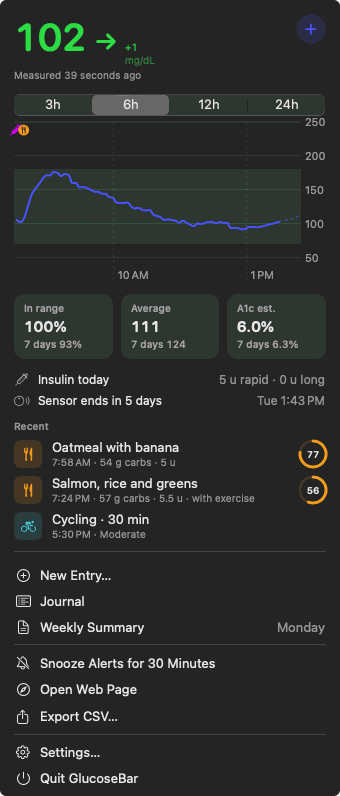
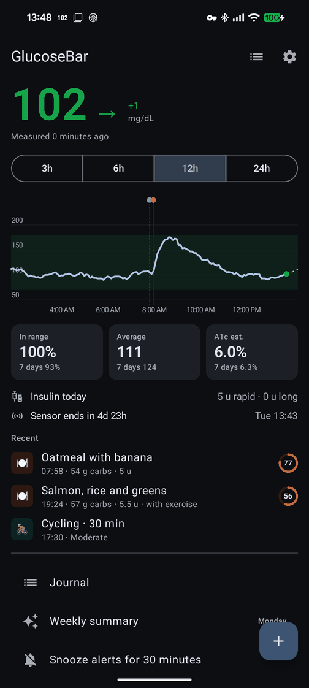
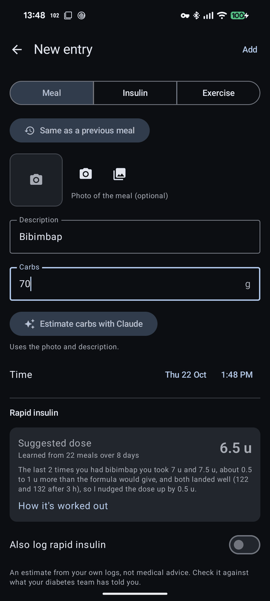
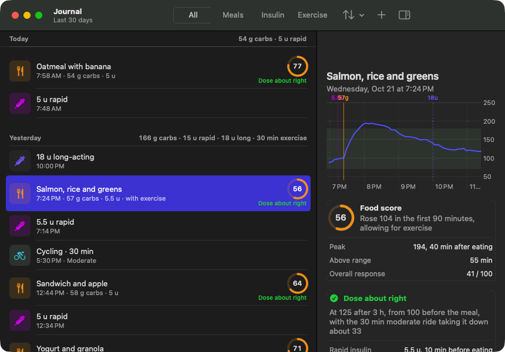
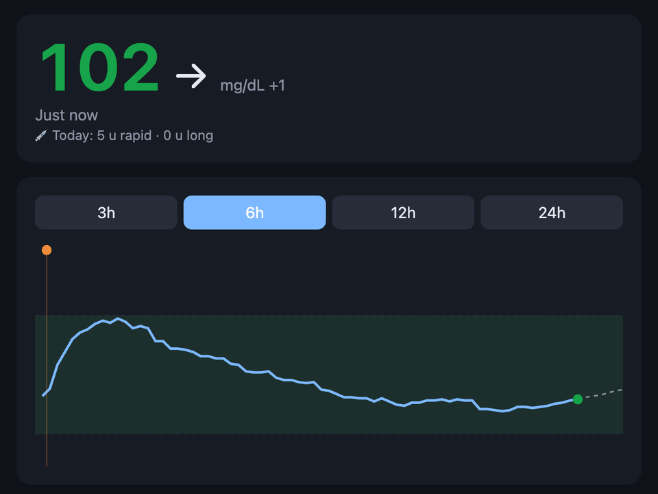

# GlucoseBar

FreeStyle Libre glucose in the macOS menu bar, the Windows tray and an Android status bar, read from the LibreView cloud (no phone debugging).

Phone (Libre app) → LibreView cloud → LibreLinkUp API → `server/libre_server.py` (port 8765, SQLite history) → `GlucoseBar.app`, GlucoseTray, the Android app and the web page

The server is a Python script (standard library only for glucose) and runs on any computer with Python 3: the installer sets it up on a Mac, and it runs the same way on Linux or Windows (see [Running the server elsewhere](#running-the-server-elsewhere)).

<p>
  
  
  
</p>
<p>
  
  
</p>

<sub>Screenshots use made-up demo data.</sub>

## Features
- Menu bar: value, trend arrow, change over 5 min, 1–3h trend line, colour by target range; optional dot-only when in range
- Dropdown: 3/6/12/24h chart, time in range / average / A1c estimate (today and 7 days), sensor expiry countdown
- Alerts: low, high, fast drop below 100 mg/dL, no data for N minutes; snooze 30 min from the notification or the menu
- Server: keeps every reading in `~/Library/Application Support/freestyle-bar/glucose.db`, CSV export, web page at `http://localhost:8765` (optionally shared on the local network)
- Settings window: units, target range, alert thresholds, menu bar display, open at login
- Forecast: 30-minute projection from the last 20 minutes (dotted line), with a "heading low" alert up to 20 minutes ahead
- Meal, insulin and exercise log (popup `+` button or the web page, including from a phone camera); Claude estimates carbs from a photo. Exercise (activity, minutes, light/moderate/hard) can be planned up to 6 hours ahead
- Journal: every entry by day, editable and deletable (here and on the web page), with each meal's glucose curve and each exercise session's response, including lows in the 12 hours after
- Exercise model: how much each kind of session lowers glucose, learned from your finished sessions (the drop beyond what logged carbs and insulin explain), plus insulin working harder for up to a day afterwards. Meal scores, dose verdicts and the learned ratios allow for it; after moderate or hard exercise, heading-low alerts come earlier for a few hours (also in the Windows tray)
- Meal impact: a 0-100 food score from the first 90 minutes after eating, plus whether the rapid insulin around it was about right, too little or too much (judged from where glucose ended up, later correction doses and lows)
- Dose suggestion when logging a meal: carb ratio (by time of day) and correction factor learned from your logged meals, starting from the 500/1800 rules for your daily dose, minus insulin still active, and less for exercise in progress, planned within 2 hours or done recently. When the meal has a description or photo estimate, Claude then compares it with the same food in your last 90 days of meals, however you worded it, and adjusts the dose for how those went (kept between half and 1.5× the formula's number). An estimate, not medical advice
- Weekly summary written by Claude every Sunday from 19:00, or on demand

Meal estimates and weekly summaries use the Claude Agent SDK, which runs on the Claude subscription you're logged into with `claude` (no API key).

## Setup
1. Install **LibreLinkUp** on your phone and create a *separate* account (a follower account).
2. In the FreeStyle Libre app: Menu → Share / Connected Apps → LibreLinkUp → add that email. Accept the invite in LibreLinkUp, and accept any terms there.
3. On a Mac, this installs the app and the server; enter the follower account's email and password when asked (the password is stored in the Keychain):
   ```
   curl -fsSL https://github.com/dogfootruler-kr/glucose-bar/releases/latest/download/install.sh | bash
   ```
   or `./install.sh` from a checkout. To run the server on another computer instead, see [Running the server elsewhere](#running-the-server-elsewhere) and install the Mac app with `--remote`.

Logs: `~/Library/Logs/freestyle-bar.log`

- Android app: the value in the status bar with a silent notification (trend, change, trend line), a home screen widget, alerts (lows can sound in Do Not Disturb), and the chart, stats, journal, meal/insulin/exercise logging with camera carb estimates, dose suggestions and weekly summary, from the same server

## Updates
Installs come from the latest [GitHub release](https://github.com/dogfootruler-kr/glucose-bar/releases) and update themselves: a launchd agent on each Mac checks at login, when GlucoseBar opens and every 6 hours (log: `~/Library/Logs/freestyle-bar-update.log`), GlucoseTray on Windows a minute after it starts and every 6 hours, and the Android app every 6 hours (the first update asks to confirm; after that it installs itself). Settings → Server → Check for Updates (or *Check for updates* in the Windows tray menu) checks right away. The installed server code lives in `~/Library/Application Support/freestyle-bar/current`; the version is shown in Settings → Server.

To publish a release, add a `## v1.2.0` section to [CHANGELOG.md](CHANGELOG.md), commit, then tag: `git tag v1.2.0 && git push origin v1.2.0`. The release workflow builds the Mac app and the Android APK (signed with the key in the `ANDROID_*` repository secrets; a backup is in `~/.config/freestyle-bar/android-release.*` on the server), attaches them and uses that section as the release notes (it stops if the section is missing).

To run your own changes on a Mac, `./install.sh --dev` builds the app and installs the server from the checkout; the updater leaves a dev install alone until you run `./install.sh` again.

## Running the server elsewhere
The server needs Python 3 and nothing else for glucose; meal estimates and weekly summaries also need the Claude Agent SDK and a `claude` login on that computer. On Linux (on Windows, the same with `.venv\Scripts\python` and the config at `%USERPROFILE%\.config\freestyle-bar\config.json`):

```
git clone https://github.com/dogfootruler-kr/glucose-bar && cd glucose-bar
python3 -m venv .venv && .venv/bin/pip install claude-agent-sdk   # optional, for the Claude features
mkdir -p ~/.config/freestyle-bar
echo '{"email": "you@example.com", "password": "..."}' > ~/.config/freestyle-bar/config.json
.venv/bin/python server/libre_server.py
```

Outside macOS there's no Keychain, so the password goes in `config.json` (keep the file private, e.g. `chmod 600`). Readings are stored under `~/Library/Application Support/freestyle-bar/` in your home folder on every system. Keep it running with whatever the system offers (a systemd user service, Task Scheduler, …); the self-updater is Mac-only, so update with `git pull` and a restart.

## Other computers (Tailscale)
One computer runs the server; others read from it over [Tailscale](https://tailscale.com), so nothing is exposed to the internet or the local network and there's one shared history and meal log.

- **Server**: on a Mac, `brew install tailscale`, then run `tailscaled --tun=userspace-networking` as a launchd agent (no admin rights needed) and `tailscale up --hostname=glucose-work`. Inbound tailnet connections reach `127.0.0.1:8765`, so `"lan"` can stay `false`. Elsewhere, install Tailscale the usual way and run `tailscale up --hostname=glucose-work`; with the normal (kernel) networking, tailnet connections arrive on the Tailscale address rather than localhost, so set `"lan": true` (and keep the port closed to the local network with the firewall if you like), or run `tailscaled` in userspace mode as on the Mac.
- **Other Mac**: install Tailscale, log in with the same account, then run the installer with `--remote` (app only):
  `curl -fsSL https://github.com/dogfootruler-kr/glucose-bar/releases/latest/download/install.sh | bash -s -- --remote http://glucose-work:8765`. The address can also be changed in Settings → Server.
- **Windows**: install Tailscale, log in, then run `powershell -ExecutionPolicy Bypass -c "irm https://github.com/dogfootruler-kr/glucose-bar/releases/latest/download/install.ps1 | iex"` (or double-click `windows/install.cmd` in a checkout). GlucoseTray shows the value in the system tray (colour by range), the trend in the tooltip, low/high/no-data notifications, and opens the web page on click. Settings: `%APPDATA%\GlucoseTray\config.json`.
- **Android**: install Tailscale, log in, then open `https://github.com/dogfootruler-kr/glucose-bar/releases/latest/download/GlucoseBar.apk` on the phone and install it (allow installing from the browser when asked). Allow notifications, background use and, in Settings, Do Not Disturb access so lows break through. The server address defaults to `http://glucose-work:8765` (Settings → Server). To try changes from a checkout: `cd android && ./gradlew installDebug` (a `dev` build, which doesn't update itself and has to be uninstalled before a release build can replace it).
- **Any browser or phone** on the tailnet: `http://glucose-work:8765`.

The server only answers requests addressed to localhost, an IP address, a short name, or a `.local` / `.ts.net` name; add any other name under `"hosts"` in `~/.config/freestyle-bar/config.json`.

If the short name doesn't resolve, use the full MagicDNS name (`glucose-work.<tailnet>.ts.net`) or the `100.x` address from `tailscale ip`.

## Server API
| Path | |
|---|---|
| `/` | web page |
| `/glucose?hours=12` | latest reading, delta, sensor, history |
| `/stats?low=70&high=180` | today / 7-day stats |
| `/export.csv` | all stored readings |
| `/events` | GET / POST meals, insulin and exercise; `PATCH` / `DELETE /events/<id>` |
| `/meals?days=30` | meals with glucose impact and dose outcome |
| `/exercise?days=30` | exercise with how glucose responded, during and in the 12 h after |
| `/dose?carbs=50&target=120` | rapid-insulin suggestion and the learned ratios |
| `POST /dose/history` | the same, adjusted by Claude for how similar past meals went |
| `/readings?start=&end=` | readings between two Unix times |
| `/meals/estimate` | POST photo/text, returns a carb estimate |
| `/summary`, `/summary/generate` | weekly summary |
