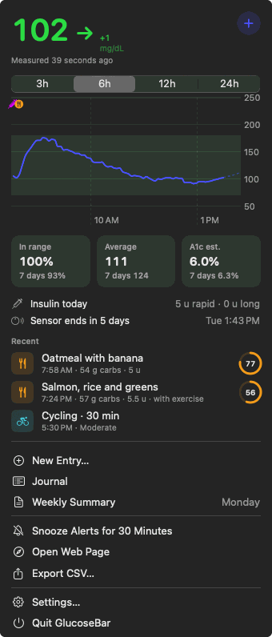
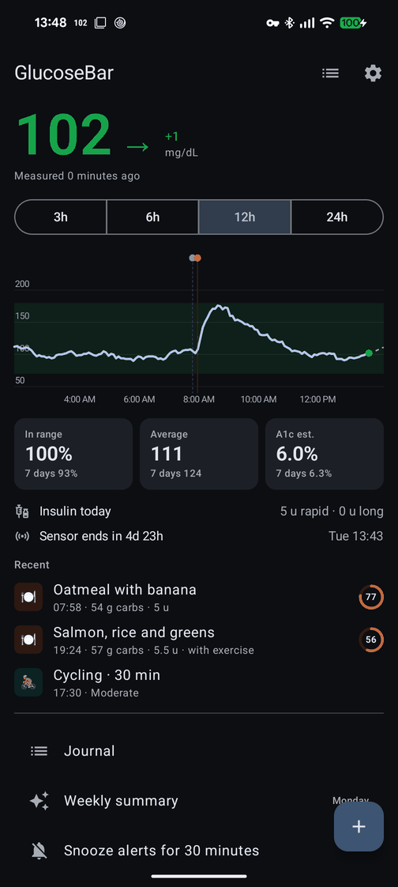
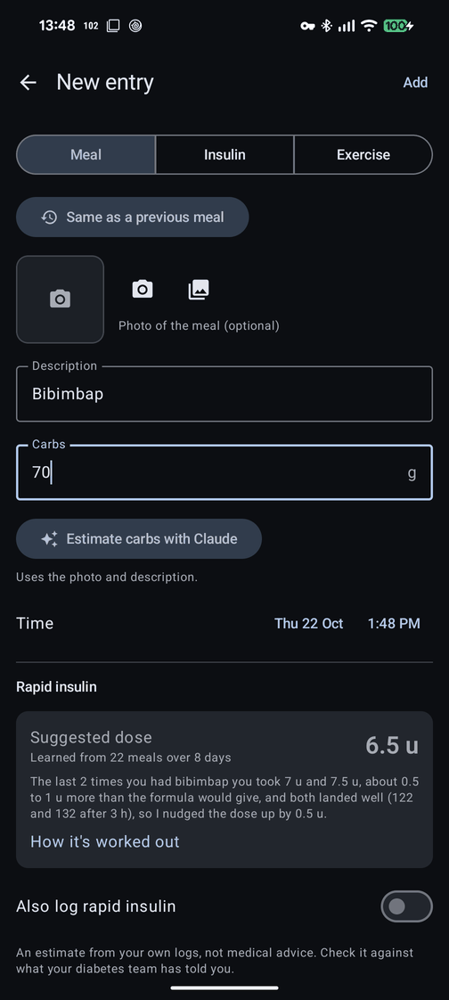
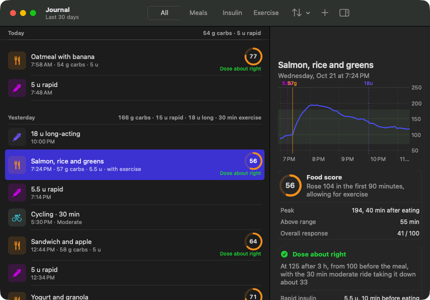
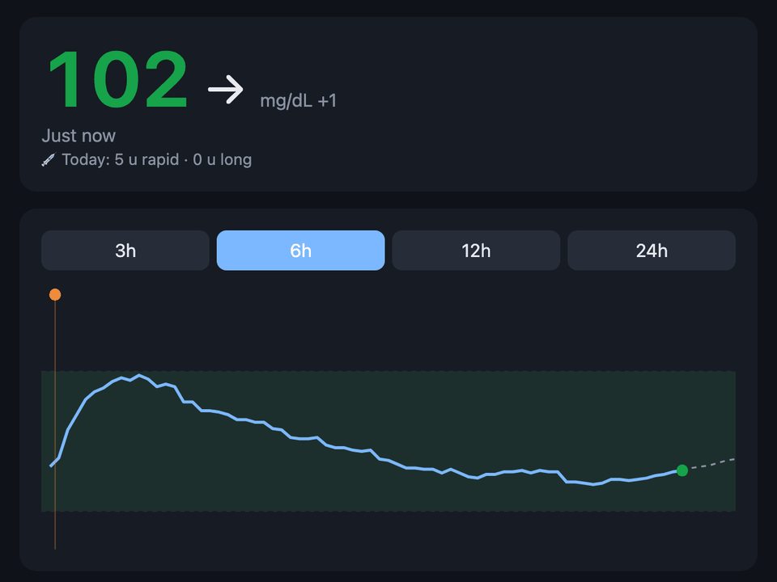

# GlucoseBar

FreeStyle Libre glucose in the macOS menu bar, the Windows tray and an Android status bar, read from the LibreView cloud.

Phone (Libre app) → LibreView cloud → LibreLinkUp API → `server/libre_server.py` (port 8765, SQLite history) → `GlucoseBar.app`, GlucoseTray, the Android app and the web page

The server is a Python script (standard library only for glucose) and runs on any computer with Python 3: the installer sets it up on a Mac, and it runs the same way on Linux or Windows (see [Running the server elsewhere](#running-the-server-elsewhere)).

<p>
  
  
  
</p>
<p>
  
  
</p>

<sub>Screenshots use made-up demo data.</sub>

## Features
- Menu bar: value, trend arrow, change over 5 min, 1–3h trend line, colour by target range; optional dot-only when in range
- Dropdown: 3/6/12/24h chart, time in range / average / A1c estimate (today and 7 days), sensor expiry countdown
- Alerts: low, high, fast drop below 100 mg/dL, no data for N minutes; snooze 30 min from the notification or the menu
- Server: keeps every reading in `~/Library/Application Support/freestyle-bar/glucose.db`, CSV export, web page at `http://localhost:8765` (optionally shared on the local network)
- Settings window: units, target range, alert thresholds, menu bar display, open at login
- Forecast: 30-minute projection from the last 20 minutes (dotted line), with a "heading low" alert up to 20 minutes ahead
- Meal, insulin and exercise log (popup `+` button or the web page, including from a phone camera); Claude estimates carbs from a photo. Exercise (activity, minutes, light/moderate/hard) can be planned up to 6 hours ahead
- Journal: every entry by day, editable and deletable (here and on the web page), with each meal's glucose curve and each exercise session's response, including lows in the 12 hours after
- Exercise model: how much each kind of session lowers glucose, learned from your finished sessions (the drop beyond what logged carbs and insulin explain), plus insulin working harder for up to a day afterwards. Meal scores, dose verdicts and the learned ratios allow for it; after moderate or hard exercise, heading-low alerts come earlier for a few hours (also in the Windows tray)
- Meal impact: a 0-100 food score from the first 90 minutes after eating, plus whether the rapid insulin around it was about right, too little or too much (judged from where glucose ended up, later correction doses and lows)
- Dose suggestion when logging a meal: carb ratio (by time of day) and correction factor learned from your logged meals, starting from the 500/1800 rules for your daily dose, minus insulin still active, and less for exercise in progress, planned within 2 hours or done recently. When the meal has a description or photo estimate, Claude then compares it with the same food in your last 90 days of meals, however you worded it, and adjusts the carb part of the dose for how those went (by at most half of it, and never more than 2 u up). Capped per dose, and no insulin when you're low or heading low (see [Dose safety limits](#dose-safety-limits)). An estimate, not medical advice
- Weekly summary written by Claude every Sunday from 19:00, or on demand

Meal estimates, the dose adjustment from past meals and weekly summaries use Claude by default, through the Claude Agent SDK on the subscription you're logged into with `claude` (no API key). They can use the Gemini API or any OpenAI-compatible API instead (Groq, a local Ollama model, …): see [AI providers](#ai-providers).

## Setup
1. Install **LibreLinkUp** on your phone and create a *separate* account (a follower account).
2. In the FreeStyle Libre app: Menu → Share / Connected Apps → LibreLinkUp → add that email. Accept the invite in LibreLinkUp, and accept any terms there.
3. On a Mac, this installs the app and the server; enter the follower account's email and password when asked (the password is stored in the Keychain):
   ```
   curl -fsSL https://github.com/dogfootruler-kr/glucose-bar/releases/latest/download/install.sh | bash
   ```
   or `./install.sh` from a checkout. To run the server on another computer instead, see [Running the server elsewhere](#running-the-server-elsewhere) and install the Mac app with `--remote`.

Logs: `~/Library/Logs/freestyle-bar.log`

- Android app: the value in the status bar with a silent notification (trend, change, trend line), a home screen widget, alerts (lows can sound in Do Not Disturb), and the chart, stats, journal, meal/insulin/exercise logging with camera carb estimates, dose suggestions and weekly summary, from the same server

## Updates
Installs come from the latest [GitHub release](https://github.com/dogfootruler-kr/glucose-bar/releases) and update themselves: a launchd agent on each Mac checks at login, when GlucoseBar opens and every 6 hours (log: `~/Library/Logs/freestyle-bar-update.log`), GlucoseTray on Windows a minute after it starts and every 6 hours, and the Android app every 6 hours (the first update asks to confirm; after that it installs itself). Settings → Server → Check for Updates (or *Check for updates* in the Windows tray menu) checks right away. The installed server code lives in `~/Library/Application Support/freestyle-bar/current`; the version is shown in Settings → Server.

To publish a release, add a `## v1.2.0` section to [CHANGELOG.md](CHANGELOG.md), commit, then tag: `git tag v1.2.0 && git push origin v1.2.0`. The release workflow builds the Mac app and the Android APK (signed with the key in the `ANDROID_*` repository secrets; a backup is in `~/.config/freestyle-bar/android-release.*` on the server), attaches them and uses that section as the release notes (it stops if the section is missing).

To run your own changes on a Mac, `./install.sh --dev` builds the app and installs the server from the checkout; the updater leaves a dev install alone until you run `./install.sh` again.

Tests run on every push and pull request (`.github/workflows/test.yml`), and again before a release is built. To run them locally:

```bash
python3 -m unittest discover -s server/tests
```

```bash
cd app && swift test
```

```bash
cd android && ./gradlew testDebugUnitTest
```

## Running the server elsewhere
The server needs Python 3 and nothing else for glucose. With Claude, meal estimates and weekly summaries also need the Claude Agent SDK and a `claude` login on that computer; the other [AI providers](#ai-providers) need only an API key. On Linux (on Windows, the same with `.venv\Scripts\python` and the config at `%USERPROFILE%\.config\freestyle-bar\config.json`):

```
git clone https://github.com/dogfootruler-kr/glucose-bar && cd glucose-bar
python3 -m venv .venv && .venv/bin/pip install claude-agent-sdk   # only for the Claude provider
mkdir -p ~/.config/freestyle-bar
echo '{"email": "you@example.com", "password": "...", "ai": {"provider": "gemini", "apiKey": "..."}}' > ~/.config/freestyle-bar/config.json
.venv/bin/python server/libre_server.py
```

Outside macOS there's no Keychain, so the password goes in `config.json` (keep the file private, e.g. `chmod 600`). Readings are stored under `~/Library/Application Support/freestyle-bar/` in your home folder on every system. Keep it running with whatever the system offers (a systemd user service, Task Scheduler, …); the self-updater is Mac-only, so update with `git pull` and a restart.

A free cloud VM works too, so no computer of yours has to stay on: an Oracle Cloud *Always Free* ARM instance (Seoul and Chuncheon regions in Korea) or a Google Cloud e2-micro, with the server as a systemd service, Tailscale for access and the Gemini provider for the AI features. Keep `"lan": false` and don't open port 8765 in the cloud firewall; Tailscale is the only way in.

## AI providers
Set under `"ai"` in `~/.config/freestyle-bar/config.json`, then restart the server. The server log says which provider it uses at startup (`AI: gemini (...)`).

| Provider | Config | Notes |
|---|---|---|
| Claude (default) | `{"provider": "claude"}` | Claude Agent SDK on your `claude` subscription login; used when `"ai"` is missing and the SDK is installed |
| Gemini | `{"provider": "gemini", "apiKey": "..."}` | Key from [Google AI Studio](https://aistudio.google.com/apikey) (or the `GEMINI_API_KEY` environment variable). Uses `gemini-flash-latest`, then `gemini-3.6-flash` and `gemini-flash-lite-latest` while the newer ones are overloaded or out of free quota. Google may use free-tier requests to improve its products; a paid key isn't used that way |
| OpenAI-compatible | `{"provider": "openai", "baseUrl": "...", "model": "...", "apiKey": "..."}` | Groq (`https://api.groq.com/openai/v1`, e.g. `meta-llama/llama-4-scout-17b-16e-instruct`), Ollama (`http://localhost:11434/v1`, a vision model such as `qwen2.5vl:7b`, no key), OpenRouter, Cloudflare Workers AI or OpenAI. The model must read images for photo estimates and support JSON-schema output |
| Off | `{"provider": "none"}` | Glucose, alerts, the journal, meal scores and the formula's dose suggestions all keep working |

Optional keys for every provider: `"model"` (a name, or a list tried in order while the API is busy) and `"timeout"` in seconds (default 180; raise it for a local model on a small CPU). Busy answers (429 or 5xx) are retried twice before moving on to the next model.

## Dose safety limits
The dose suggestion follows these rules, with a warning in the app whenever one applies:
- No insulin while below the low threshold, or while the forecast says glucose will be below it within `lowLookahead` minutes.
- A rising trend adds nothing while carbs are still being absorbed, within `trendRecentMinutes` of a rapid dose, or while insulin is still active. A falling trend always lowers the dose.
- No suggestion is ever more than `maxDoseFraction` of the average total daily dose, or more than `maxDoseUnits`.
- The adjustment from past meals moves only the carb part of the dose: by at most half of it either way, and never more than `aiMaxIncrease` units up. The server log records each one.
- Requests are refused for more than `maxCarbs` grams, a target outside 70–200 mg/dL or a low outside 50–200 mg/dL.
- A low counts only once glucose has stayed below the low threshold for `lowMinMinutes` (two readings 15 minutes apart are enough). A single low reading, such as lying on the sensor gives (a compression low), isn't one. This applies when learning the ratios, judging past doses and learning from exercise.
- The learned carb ratios stay between half and twice the 500/daily-dose rule, as the sensitivity already did.
- The suggestion warns when no long-acting insulin has been logged for longer than usual (see below).

The Mac and Android apps and the web page show these warnings under the suggested dose, most serious first: heading low and below range in red, a capped dose (also marked "(capped)" next to the number) and a missed long-acting dose in orange. The Windows tray shows a notification when no long-acting has been logged for longer than usual, at most every 6 hours. Older servers send only the plain warning, and the apps still show it.

Change them under `"dosing"` in `config.json`, then restart the server. These are the defaults:

```json
"dosing": {"maxDoseFraction": 0.25, "maxDoseUnits": 15, "lowLookahead": 30, "trendRecentMinutes": 120, "aiMaxIncrease": 2, "maxCarbs": 300, "lowMinMinutes": 15, "learnMaxIob": 0.3}
```

## Correction suggestions
When glucose stays high and isn't coming down, the apps suggest a correction dose: a notification on the Mac, Android and Windows, and a line on the web page. The server decides, so every app follows the same rule. It suggests one only when all of these hold:
- the latest reading is no more than 15 minutes old;
- glucose has been above the top of your target range (the apps' own setting; `"targets"` for the web page and Windows) for at least `sustainedMinutes`, without a single reading back in range and with no gap of more than 20 minutes in the data;
- it isn't falling faster than `fallingSlope` mg/dL a minute, and there's a trend to go on;
- no rapid insulin has been logged in the last `rapidCooldownMinutes`, and no carbs are still digesting (a meal's rise is expected);
- the correction worked out by the dose suggestion for no carbs is at least `minUnits`. That's after insulin still active is taken off, never more than the dose cap, and nothing when heading low (all the [dose safety limits](#dose-safety-limits) apply).

It then reminds you again at most every `repeatMinutes` while it lasts. The message is a suggestion to check, never a dose to take blindly: for example, "Glucose has been above 180 for 40 min (now 250) and isn't coming down. If you haven't taken insulin you didn't log, consider 2.5 u. Check before dosing." It only knows about the insulin you've logged, so log every dose. Each app has a switch for it with its other alerts (`"correctionAlerts": false` in the Windows tray's settings). `GET /correction` (also `"correction"` in `/glucose`) says whether one is due and, if not, why not.

The defaults, changed under `"correctionAlerts"` in `config.json` (`"enabled": false` turns it off for every app):

```json
"correctionAlerts": {"enabled": true, "sustainedMinutes": 30, "minUnits": 1, "rapidCooldownMinutes": 180, "repeatMinutes": 120, "fallingSlope": -0.5, "maxAgeMinutes": 15}
```

## Insulin type and slow meals
The insulin still active is worked out from a curve that peaks 75 minutes after a dose and lasts 6 hours (NovoRapid, Humalog, Apidra). Fiasp and Lyumjev act sooner: set `"insulin": {"rapid": "fiasp"}` in `config.json` (or `"lyumjev"`) for a peak at 55 minutes. You can also give `"peak"` and `"dia"` (duration) in minutes, for example `{"peak": 65, "dia": 300}`.

Meals are counted as absorbing over 3 hours. One high in fat or protein can be logged as slow (`"slow": true` on the meal, or the *Slow meal* box on the web page), and its carbs are then counted as absorbing over 5 hours (`"slowMealMinutes"` under `"insulin"`). This affects the insulin-still-active deduction in later suggestions and what's learned from that meal. The dose suggested for the meal itself doesn't change.

How the ratios are learned:
- **Corrections** count only when no carbs are still absorbing, less than `learnMaxIob` (0.3 u) of earlier rapid insulin is still active, and nothing else is eaten or injected in the 3 hours after. Corrections after which glucose rose are kept as well as those after which it fell, so the sensitivity isn't biased towards the doses that worked.
- **The daily dose** behind the 500 and 1800 rules is the median over fully logged days. It leaves out today, the partly covered first day of the 30-day history, and days with under half the usual total, when most doses probably weren't logged.
- **Carb ratios by time of day** change gradually over an hour around 04:00, 11:00 and 16:00, so a meal at 10:59 and one at 11:00 get nearly the same ratio.

## Long-acting insulin checks
`GET /basal` checks the long-acting (basal) insulin from what's been logged. It only informs: no dose changes beyond the warning on the suggestion.
- **Missed dose**: the last long-acting dose and how long ago it was. After `longMissedHours` with none logged, the dose suggestion carries a warning (only once long-acting has been logged before).
- **Fasting drift**: how fast glucose rises or falls, in mg/dL per hour, during stretches of at least `fastingMinHours` with no logged carbs and no low for `fastingCarbHours` before, less than `fastingMaxIob` units of rapid insulin active, and no exercise for `exerciseClearHours`. Stretches are cut at midnight, and each day over the last `driftDays` gets one number. It's flagged when it's beyond ±`driftLimit` on at least `driftMinDays` days and on more than half of the days measured. Overnight rises also come from the dawn effect, and unlogged snacks look like a rise.
- **Share of the daily dose**: long-acting as a share of all insulin, over past days with both kinds logged (at least `shareMinDays`), flagged outside `shareMin`–`shareMax`.

The defaults, changed under `"basal"` in `config.json`:

```json
"basal": {"longMissedHours": 26, "fastingCarbHours": 4, "fastingMaxIob": 0.3, "fastingMinHours": 3, "exerciseClearHours": 6, "driftLimit": 15, "driftDays": 14, "driftMinDays": 3, "shareMin": 0.3, "shareMax": 0.6, "shareMinDays": 3}
```

## Time zone and web page targets
The carb ratios by time of day, daily doses, today's stats, weekly summaries and times in messages use the server's own time zone. A server somewhere else than you, such as a cloud VM in UTC, should be given yours as an IANA name: `"timezone": "Asia/Seoul"` in `config.json` (on Windows this needs `pip install tzdata`). The server refuses to start with a name it doesn't know.

The apps keep their own target range and dose target in their settings. The web page has no settings, so it uses `"targets"` from `config.json` (shown at `GET /settings`). These are the defaults: `"targets": {"low": 70, "high": 180, "doseTarget": 120}`.

## Other computers (Tailscale)
One computer runs the server; others read from it over [Tailscale](https://tailscale.com), so nothing is exposed to the internet or the local network and there's one shared history and meal log.

- **Server**: on a Mac, `brew install tailscale`, then run `tailscaled --tun=userspace-networking` as a launchd agent (no admin rights needed) and `tailscale up --hostname=glucose-work`. Inbound tailnet connections reach `127.0.0.1:8765`, so `"lan"` can stay `false`. Elsewhere, install Tailscale the usual way and run `tailscale up --hostname=glucose-work`; with the normal (kernel) networking, tailnet connections arrive on the Tailscale address rather than localhost, so set `"lan": true` (and keep the port closed to the local network with the firewall if you like), or run `tailscaled` in userspace mode as on the Mac.
- **Other Mac**: install Tailscale, log in with the same account, then run the installer with `--remote` (app only):
  `curl -fsSL https://github.com/dogfootruler-kr/glucose-bar/releases/latest/download/install.sh | bash -s -- --remote http://glucose-work:8765`. The address can also be changed in Settings → Server.
- **Windows**: install Tailscale, log in, then run `powershell -ExecutionPolicy Bypass -c "irm https://github.com/dogfootruler-kr/glucose-bar/releases/latest/download/install.ps1 | iex"` (or double-click `windows/install.cmd` in a checkout). GlucoseTray shows the value in the system tray (colour by range), the trend in the tooltip, low/high/no-data notifications, and opens the web page on click. Settings: `%APPDATA%\GlucoseTray\config.json`.
- **Android**: install Tailscale, log in, then open `https://github.com/dogfootruler-kr/glucose-bar/releases/latest/download/GlucoseBar.apk` on the phone and install it (allow installing from the browser when asked). Allow notifications, background use and, in Settings, Do Not Disturb access so lows break through. The server address defaults to `http://glucose-work:8765` (Settings → Server). To try changes from a checkout: `cd android && ./gradlew installDebug` (a `dev` build, which doesn't update itself and has to be uninstalled before a release build can replace it).
- **Any browser or phone** on the tailnet: `http://glucose-work:8765`.

The server only answers requests addressed to localhost, an IP address, a short name, or a `.local` / `.ts.net` name; add any other name under `"hosts"` in `~/.config/freestyle-bar/config.json`.

If the short name doesn't resolve, use the full MagicDNS name (`glucose-work.<tailnet>.ts.net`) or the `100.x` address from `tailscale ip`.

## Server API
| Path | |
|---|---|
| `/` | web page |
| `/glucose?hours=12` | latest reading, delta, sensor, history |
| `/stats?low=70&high=180` | today / 7-day stats |
| `/export.csv` | all stored readings |
| `/events` | GET / POST meals, insulin and exercise; `PATCH` / `DELETE /events/<id>` |
| `/meals?days=30` | meals with glucose impact and dose outcome |
| `/exercise?days=30` | exercise with how glucose responded, during and in the 12 h after |
| `/dose?carbs=50&target=120&slow=0` | rapid-insulin suggestion and the learned ratios, with its warnings in `alerts` |
| `POST /dose/history` | the same, adjusted by Claude for how similar past meals went |
| `/correction?high=180&low=70&target=120` | whether a correction suggestion is due, and why not |
| `/basal?low=70` | long-acting checks: last dose, fasting drift, share of the daily dose |
| `/settings` | the target range and dose target the web page uses, and the time zone |
| `/readings?start=&end=` | readings between two Unix times |
| `/meals/estimate` | POST photo/text, returns a carb estimate |
| `/summary`, `/summary/generate` | weekly summary |
